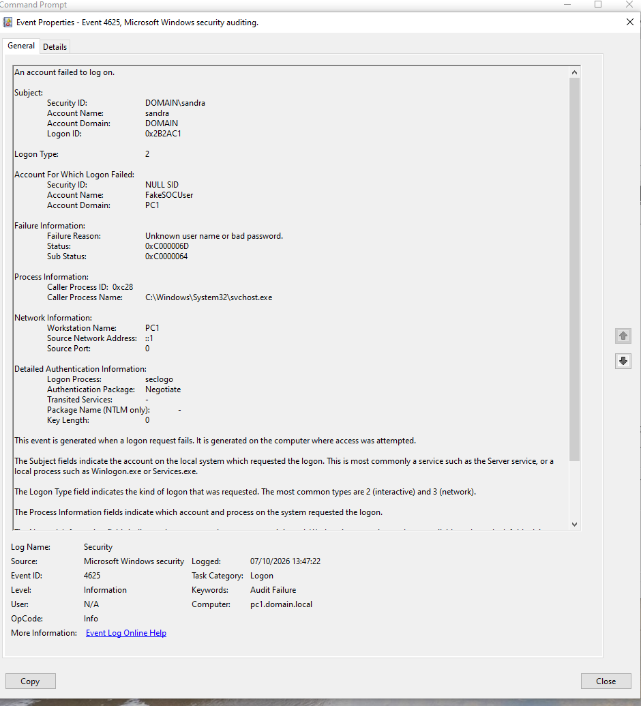

# 🔍 Windows Event Log Investigation

## Overview

This project documents a hands-on investigation of Windows authentication events using Windows Event Viewer.

The lab was designed to generate controlled failed logon attempts and analyze the resulting Windows Security events from a SOC analyst perspective.

---

## 🎯 Objective

The objectives of this investigation were to:

- Generate controlled failed authentication attempts
- Identify the corresponding Windows Security Event
- Analyze the account, logon type, source address, and failure reason
- Determine whether repeated failed logons are sufficient to classify the activity as a brute-force attack

---

## 🖥️ Environment

- Windows virtual machine
- Windows Event Viewer
- Command Prompt
- Windows Security Log
## 🧪 Lab Scenario

Three controlled failed authentication attempts were generated from the local Windows machine using:

```cmd
runas /user:FakeSOCUser cmd
```

An invalid password was entered during each attempt.

The purpose was to observe how failed authentication activity appears in the Windows Security Log.

---

## 🔎 Evidence 1 — Failed Logon Event



Windows Event Viewer recorded:

**Event ID: 4625 — An account failed to log on**

### Key Information

| Field | Value |
|---|---|
| Event ID | 4625 |
| Account Name | FakeSOCUser |
| Logon Type | 2 |
| Failure Reason | Unknown user name or bad password |
| Workstation Name | PC1 |
| Source Network Address | ::1 |

### Analysis

Event ID **4625** indicates a failed logon attempt.

The target account was `FakeSOCUser`.

The event recorded **Logon Type 2**, which represents an interactive logon.

The source address was `::1`, the IPv6 loopback address. In the context of this controlled lab, this is consistent with locally generated authentication activity.

The failure reason was:

> Unknown user name or bad password.

Three failed attempts occurred in a short period of time. Repeated authentication failures can indicate brute-force activity; however, three failed attempts alone are not sufficient to confirm a brute-force attack.

Additional context and authentication events would be required before classifying the activity as malicious.

---

## 🔍 Evidence 2 — Successful Logon Analysis

During the investigation, **Event ID 4624** events were reviewed to determine whether any successful authentication could be correlated with the failed logon attempts involving `FakeSOCUser`.

A successful authentication event was identified for the account `sandra`.

### Key Information

| Field | Value |
|---|---|
| Event ID | 4624 |
| Account Name | sandra |
| Account Domain | DOMAIN |
| Logon Type | 7 |
| Result | Successful |
| Computer | pc1.domain.local |

## Final Analyst Assessment

**Classification:** Suspicious Authentication Activity

**Account Compromise Confirmed:** No

**Brute Force Confirmed:** No

Multiple failed authentication attempts were observed for `FakeSOCUser`. However, no successful authentication for the same account was identified during the investigation.

Successful Event ID 4624 activity associated with `sandra` was reviewed, but the different account and logon context mean that it cannot be considered evidence of a successful compromise following the failed attempts.

Based on the available evidence, the activity remains classified as **suspicious authentication activity with insufficient evidence to confirm account compromise**.

### Recommended Next Steps

- Review additional Event ID 4625 events for repeated authentication failures.
- Search for Event ID 4624 events involving the same target account.
- Compare timestamps, account names, logon types, workstation names, and source addresses.
- Look for unusual authentication frequency or attempts against multiple accounts.
- Correlate authentication activity with endpoint and network telemetry.
---

## 🛡️ Final Analyst Conclusion

**Classification:** Suspicious Authentication Activity  
**Account Compromise Confirmed:** No  
**Brute Force Confirmed:** No

Multiple failed authentication attempts were observed for `FakeSOCUser`. However, no successful authentication for the same account was identified during the investigation.

Successful Event ID 4624 activity associated with `sandra` was reviewed, but the different account and logon context mean that it cannot be considered evidence of a successful compromise following the failed attempts.

Based on the available evidence, the activity remains classified as **suspicious authentication activity with insufficient evidence to confirm account compromise**.
---

## 📚 What I Learned

Through this investigation, I practiced:

- Windows Security Event analysis
- Investigating Event IDs 4624 and 4625
- Authentication log analysis
- Understanding Windows Logon Types
- Identifying IPv6 loopback traffic
- Correlating successful and failed authentication events
- Distinguishing suspicious activity from confirmed malicious activity
- Avoiding false correlation between unrelated security events
- Making evidence-based SOC conclusions
